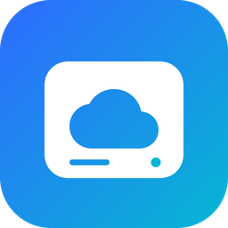
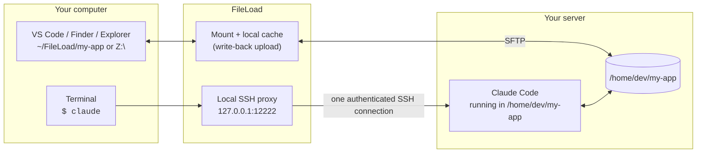
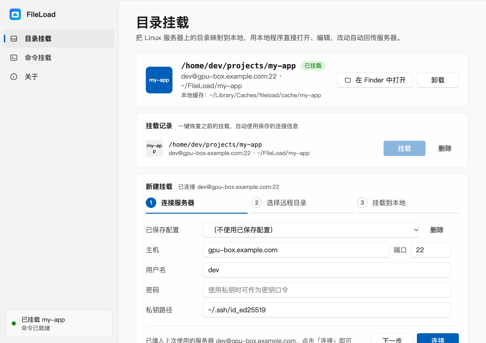
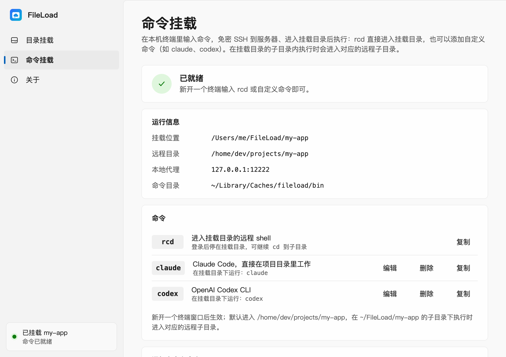

<p align="center">
  
</p>

<h1 align="center">FileLoad</h1>

<p align="center">
  <b>Run Claude Code on your server from any laptop — and watch every edit it makes in a local folder.</b><br>
  Mount a remote SSH directory as a local drive (Windows) or folder (macOS), and launch remote commands like <code>claude</code> from any local terminal, password-free.
</p>

<p align="center">
  <a href="https://github.com/KoLoRang/fileload/releases/latest"></a>
  <a href="https://github.com/KoLoRang/fileload/releases"></a>
  <a href="https://github.com/KoLoRang/fileload/actions/workflows/ci.yml"></a>
  
  <a href="LICENSE"></a>
</p>

<p align="center">
  <a href="https://kolorang.github.io/fileload/">Website</a> ·
  <a href="https://github.com/KoLoRang/fileload/releases/latest">Download</a> ·
  <a href="README.zh-CN.md">简体中文</a>
</p>

---

## Claude Code on your server, from anywhere

Coding agents work best next to the code: on the box with the GPUs, the datasets, the full toolchain and a fast network. FileLoad makes that server feel local:

- **Type `claude` in any local terminal.** FileLoad's built-in SSH proxy logs you in (no password or key prompts) and starts Claude Code **inside the mounted project directory**. Run it from a sub-folder of the mount and it starts in the matching remote sub-folder.
- **Watch the agent's work live in your own tools.** The same directory is mounted locally, so you can browse, diff and review what Claude Code changes in VS Code, Finder or Explorer while it works. Every time a file is opened it is checked against the server, so you always read the agent's latest version.
- **Edit alongside it.** Your local saves are written back to the server automatically, so you and the agent work on the same files.
- **Your laptop is just a window.** Code, build and agent all run on the server. Tip: set the remote command to `tmux new -As claude claude` and the session survives Wi-Fi drops and closed lids.

Works the same for `codex`, `aider`, `gemini` or any other CLI: one custom command each.



## Screenshots

> The UI is currently in Simplified Chinese; English UI is on the roadmap.

| Directory mount | Commands (`rcd`, `claude`, `codex`) |
| --- | --- |
|  |  |

## Quick start

1. **Install** from the [latest release](https://github.com/KoLoRang/fileload/releases/latest):
   | OS | File | Notes |
   | --- | --- | --- |
   | Windows 10/11 x64 | `FileLoad-Setup-<version>.exe` | All-in-one installer: also installs the WinFsp driver if needed |
   | macOS 13+ (Apple silicon & Intel) | `FileLoad-<version>-macos.dmg` | Drag to Applications. The app is not notarized: the first time, right-click › Open. FileLoad offers a one-click install of FUSE-T on first mount |
2. **Connect**: enter host, port, user, and a password or private key. Servers are remembered.
3. **Pick a remote directory** in the built-in browser, e.g. `/home/dev/my-app`.
4. **Mount**: pick a drive letter (Windows) or folder (macOS, default `~/FileLoad/<name>`). Open it in your editor.
5. **Add a command**: on the *命令挂载 (Commands)* page add name `claude`, remote command `claude` (Claude Code must be installed on the server). Open a **new** terminal and type `claude`.

The built-in `rcd` command opens a remote shell that starts in the mounted directory.

## Features

- **Mount over plain SSH/SFTP**: nothing to install on the server. WinFsp on Windows and FUSE-T on macOS (no kernel extension).
- **Read cache**: a file is downloaded once and then served locally. It is re-validated against the remote size + mtime every time it's opened.
- **Write-back**: writes land in the local cache and are uploaded by a background queue; pending uploads are flushed on unmount and survive crashes.
- **Local commands that run remotely**: `rcd` plus your own commands (`claude`, `codex`, `make test`…). They go through a loopback SSH proxy that reuses FileLoad's authenticated connection: no extra password prompts and no key setup. The command directory is put at the **front** of `PATH`, so the commands win over same-named local tools.
- **Mount history**: re-mount a previous setup with one click.
- **Resilient**: automatic reconnect and a 15 s keepalive.
- **Tray / menu-bar**: close the window and keep the mount running.
- **One-click auto-update** from GitHub Releases: download, install, relaunch.
- Light/dark theme following the system, with Mica on Windows 11.

## How it works

| Piece | What it does |
| --- | --- |
| `internal/vfs` + cgofuse | FUSE file system served by WinFsp (Windows) or FUSE-T (macOS) |
| `internal/cache` | Whole-file read cache plus a dirty-file upload queue; dirty markers survive crashes |
| `internal/backend/sftp` | SSH/SFTP client with reconnect, keepalive and a shared connection pool |
| `internal/proxy` | Loopback SSH server on `127.0.0.1:12222+` that forwards sessions (PTY included) to the real server |
| `internal/platform` | Generates the command wrappers (`.cmd`/`.ps1` or `sh`) and manages `PATH` |
| `internal/ui/desktop` + `frontend/` | Wails v3 window; plain HTML/CSS/JS UI with no build step |

## FAQ

**Does anything need to be installed on the server?** No, only an SSH server with SFTP enabled (the default for OpenSSH). Install whatever CLI you want to run there (e.g. Claude Code).

**Can I pass arguments, like `claude --resume`?** Arguments typed after a local command are not forwarded yet. Add a second command instead, e.g. name `claude-resume`, remote command `claude --resume`.

**Will I see changes the agent makes right away?** A file is checked against the server whenever it's opened, so re-opening or refreshing shows the newest content. Editors that watch files may need focus or a refresh to notice.

**Where are my settings and passwords?** They stay local: `%APPDATA%\fileload` on Windows, `~/Library/Application Support/fileload` on macOS. Passwords are currently stored in plain text there, so private keys are recommended. Cache, command wrappers and logs live in `%LOCALAPPDATA%\fileload` or `~/Library/Caches/fileload`. Set `FILELOAD_HOME=<dir>` to keep everything in one folder (portable mode).

**Is the local proxy exposed to the network?** No. It listens on `127.0.0.1` only, and only while a mount is active.

## Known limitations

- One active mount at a time; unmount before mounting another directory.
- Large files are downloaded whole on first open (no partial/streaming reads).
- `rcd` and custom commands are interactive SSH sessions (a TUI like Claude Code works exactly as over normal SSH), not background jobs. Use `tmux` on the server if you want them to outlive the connection.
- UI language is Simplified Chinese for now.

## Build from source

Requirements: Go 1.26+ and a C compiler (cgo, needed by cgofuse). Run everything from the repository root; outputs go to `dist/`.

**macOS** (needs Xcode command line tools; FUSE-T does *not* need to be installed, because the script downloads the pinned installer and uses its headers):

```bash
scripts/build_macos.sh                  # native arch → dist/FileLoad.app + dist/FileLoad-<version>-macos.dmg
ARCH=universal scripts/build_macos.sh   # arm64 + amd64
NODMG=1 scripts/build_macos.sh          # .app only (faster)
```

**Windows**: needs MinGW gcc + windres, the WinFsp FUSE headers (`fuse.h`, `fuse_common.h`, `fuse_opt.h`, `winfsp_fuse.h` from [winfsp/inc/fuse](https://github.com/winfsp/winfsp/tree/master/inc/fuse) in `winfsp_inc\`), Python with Pillow, and for the installer [Inno Setup 6](https://jrsoftware.org/isinfo.php) plus `dist\winfsp-2.1.msi` from the [WinFsp releases](https://github.com/winfsp/winfsp/releases/tag/v2.1):

```powershell
$env:CPATH = "$PWD\winfsp_inc"
python assets/make_ico.py                                    # dist\fileload.ico
windres --codepage=65001 -i build/windows/app.rc -O coff -o cmd/fileload/rsrc_windows_amd64.syso --target=pe-x86-64
go build -trimpath -tags production -ldflags="-s -w -H windowsgui" -o dist/FileLoad.exe ./cmd/fileload
ISCC.exe build\windows\installer.iss                         # dist\FileLoad-Setup-<version>.exe
```

**Tests**: `go test ./...`. The integration tests against a real SSH server are opt-in via `FILELOAD_IT_*` variables (see the header of `internal/backend/sftp/client_test.go`); the real mount test on macOS also needs `FILELOAD_FUSE=1` with FUSE-T installed.

## Releasing

Releases are built by GitHub Actions ([`release.yml`](.github/workflows/release.yml)) when a `v*` tag is pushed:

```bash
python scripts/bump_version.py 1.0.1      # updates update.go, app.rc and installer.iss
git commit -am "v1.0.1" && git tag v1.0.1 && git push --follow-tags
```

The workflow checks that the tag matches the version in the code, runs the tests, builds the universal macOS dmg and the Windows installer, and publishes them with SHA-256 checksums. The in-app updater finds the assets by name (`*.dmg`, `*Setup*.exe`).

## License

FileLoad is [MIT licensed](LICENSE).

It relies on these third-party components, each under its own license:
- [WinFsp](https://github.com/winfsp/winfsp) (GPLv3 with a FLOSS exception) is installed by the Windows installer.
- [FUSE-T](https://www.fuse-t.org) is free for non-commercial use; check its terms before using it commercially. Its license is shipped inside the macOS dmg.
