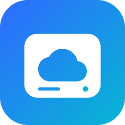
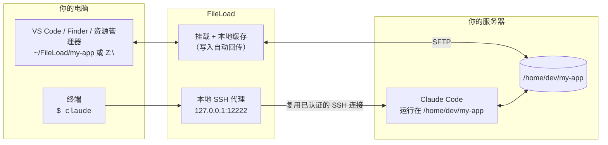
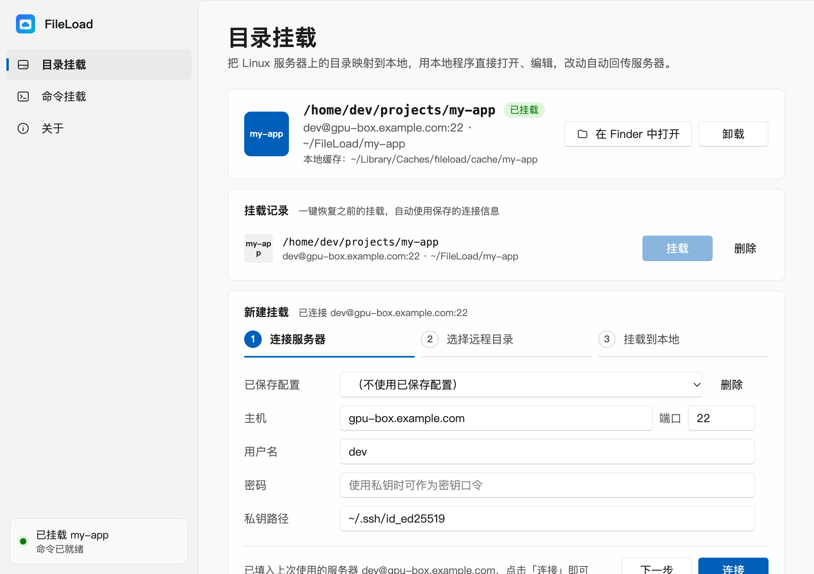
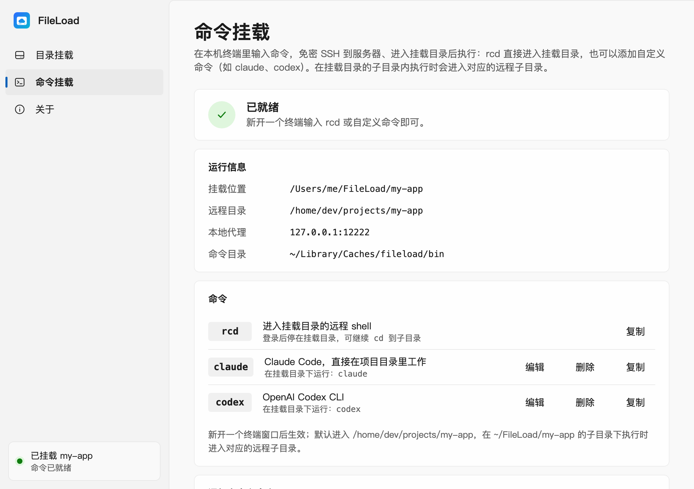

<p align="center">
  
</p>

<h1 align="center">FileLoad</h1>

<p align="center">
  <b>在任何一台电脑上远程使用服务器里的 Claude Code，并在本地文件夹里实时查看它改了什么。</b><br>
  把 SSH 服务器上的目录挂载成本地盘符（Windows）或本地目录（macOS），在本机任意终端输入 <code>claude</code> 等命令即可免密直达服务器上的项目目录。
</p>

<p align="center">
  <a href="https://github.com/KoLoRang/fileload/releases/latest"></a>
  <a href="https://github.com/KoLoRang/fileload/releases"></a>
  <a href="https://github.com/KoLoRang/fileload/actions/workflows/ci.yml"></a>
  
  <a href="LICENSE"></a>
</p>

<p align="center">
  <a href="https://kolorang.github.io/fileload/">产品主页</a> ·
  <a href="https://github.com/KoLoRang/fileload/releases/latest">下载</a> ·
  <a href="README.md">English</a>
</p>

---

## 随时随地使用服务器上的 Claude Code

编程 Agent 最好跑在代码旁边：那台有 GPU、有数据、有完整工具链和高速网络的服务器上。FileLoad 让这台服务器用起来就像在本地：

- **在本机任意终端输入 `claude`**：内置 SSH 代理自动登录（不再输密码、不用配密钥），直接在**挂载的项目目录**里启动 Claude Code；在挂载目录的子目录下执行，就进入对应的远程子目录。
- **用自己的工具实时查看 Agent 的改动**：同一个目录已挂载到本地，Claude Code 工作时，你可以在 VS Code、Finder、资源管理器里浏览、对比、审阅它改的文件；每次打开文件都会与服务器校验，看到的始终是最新内容。
- **和 Agent 一起改**：本地保存的修改自动回传服务器，你和 Agent 编辑的是同一份文件。
- **笔记本只是一扇窗**：代码、编译和 Agent 都在服务器上运行。小技巧：把远程命令设为 `tmux new -As claude claude`，断网、合盖后会话依然保留，重新输入 `claude` 即可接上。

`codex`、`aider`、`gemini` 等任意命令行工具同理，各加一条自定义命令即可。



## 截图

| 目录挂载 | 命令挂载（`rcd`、`claude`、`codex`） |
| --- | --- |
|  |  |

## 快速开始

1. **安装**：从[最新版本](https://github.com/KoLoRang/fileload/releases/latest)下载
   | 系统 | 文件 | 说明 |
   | --- | --- | --- |
   | Windows 10/11 x64 | `FileLoad-Setup-<版本>.exe` | 多合一安装包，需要时会一并安装 WinFsp 驱动 |
   | macOS 13+（Apple 芯片与 Intel） | `FileLoad-<版本>-macos.dmg` | 拖入「应用程序」；应用未经公证，首次请右键 › 打开；首次挂载时可一键安装 FUSE-T |
2. **连接服务器**：填写主机、端口、用户名，以及密码或私钥；配置会自动保存。
3. **选择远程目录**：在内置浏览器里选择，例如 `/home/dev/my-app`。
4. **挂载**：选择盘符（Windows）或本地目录（macOS，默认 `~/FileLoad/<目录名>`），然后用编辑器打开。
5. **添加命令**：在「命令挂载」页添加命令名 `claude`、远程命令 `claude`（服务器上需已安装 Claude Code）。**新开**一个终端，输入 `claude` 即可。

内置命令 `rcd` 会打开一个停在挂载目录的远程 shell。

## 功能

- **基于普通 SSH/SFTP 挂载**，服务器端无需安装任何东西；Windows 使用 WinFsp，macOS 使用 FUSE-T（无需内核扩展）
- **读缓存**：文件首次访问时整个下载到本地，之后直接读本地；每次打开都会按远端大小和修改时间重新校验
- **写回传**：写入先落本地缓存，由后台队列上传；卸载时冲刷，崩溃/断电后下次挂载继续上传
- **本地命令、远程执行**：内置 `rcd`，并可添加任意命令（`claude`、`codex`、`make test`……）。命令经由本地回环 SSH 代理，复用 FileLoad 已认证的连接，免密码、免配置密钥；命令目录加入 `PATH` 时**前置**，避免被本机同名工具覆盖
- **挂载记录**：一键恢复之前的挂载
- **断线自动重连** + 15 秒 keepalive
- **托盘/菜单栏常驻**：关闭窗口后挂载保持
- **一键自动更新**：基于 GitHub Releases，自动下载、安装并重启
- 跟随系统深浅色，Windows 11 使用 Mica 背景

## 工作原理

| 模块 | 作用 |
| --- | --- |
| `internal/vfs` + cgofuse | FUSE 文件系统，由 WinFsp（Windows）/ FUSE-T（macOS）提供挂载 |
| `internal/cache` | 整文件读缓存 + 脏文件上传队列，脏标记跨崩溃保留 |
| `internal/backend/sftp` | SSH/SFTP 客户端：重连、keepalive、共享连接池 |
| `internal/proxy` | 监听 `127.0.0.1:12222` 起的本地 SSH 服务，把会话（含 PTY）转发到真实服务器 |
| `internal/platform` | 生成命令包装脚本（`.cmd`/`.ps1` 或 `sh`）并管理 `PATH` |
| `internal/ui/desktop` + `frontend/` | Wails v3 窗口；界面是纯 HTML/CSS/JS，无需构建 |

## 常见问题

**服务器上需要装什么？** 只需要开启 SFTP 的 SSH 服务（OpenSSH 默认即开启）。想在服务器上运行的命令行工具（如 Claude Code）自行安装即可。

**能带参数吗，比如 `claude --resume`？** 目前本地命令后面的参数不会转发。可以再加一条命令，例如命令名 `claude-resume`、远程命令 `claude --resume`。

**Agent 改了文件，本地能马上看到吗？** 每次打开文件都会与服务器校验，重新打开或刷新即可看到最新内容；监听文件变化的编辑器可能需要切回窗口或手动刷新才会发现。

**配置和密码存在哪？** 都只存在本机：Windows 为 `%APPDATA%\fileload`，macOS 为 `~/Library/Application Support/fileload`。密码目前以明文保存在其中，建议使用私钥登录。缓存、命令脚本和日志在 `%LOCALAPPDATA%\fileload` 或 `~/Library/Caches/fileload`。设置环境变量 `FILELOAD_HOME=<目录>` 可把全部数据放到同一个目录（便携模式）。

**本地代理会暴露到网络吗？** 不会。它只监听 `127.0.0.1`，且只在挂载期间运行。

## 已知限制

- 同一时间只有一个挂载；换目录需先卸载
- 大文件首次打开需等整个文件下载完（暂不支持按需分块读取）
- `rcd` 和自定义命令是交互式 SSH 会话（Claude Code 等 TUI 与手动 SSH 时表现一致），不是后台任务；希望断线后继续运行，请在服务器上配合 `tmux` 使用
- 界面目前只有简体中文

## 从源码构建

依赖：Go 1.26+ 和 C 编译器（cgofuse 需要 cgo）。以下命令都在仓库根目录执行，产物放在 `dist/`。

**macOS**（需要 Xcode 命令行工具；构建机**不需要**安装 FUSE-T，脚本会下载固定版本的安装包并使用其中的头文件）：

```bash
scripts/build_macos.sh                  # 本机架构 → dist/FileLoad.app + dist/FileLoad-<版本>-macos.dmg
ARCH=universal scripts/build_macos.sh   # arm64 + amd64 通用版
NODMG=1 scripts/build_macos.sh          # 只出 .app（更快）
```

**Windows**：需要 MinGW gcc + windres、WinFsp 的 FUSE 头文件（从 [winfsp/inc/fuse](https://github.com/winfsp/winfsp/tree/master/inc/fuse) 下载 `fuse.h` `fuse_common.h` `fuse_opt.h` `winfsp_fuse.h` 到 `winfsp_inc\`）、带 Pillow 的 Python；打安装包还需要 [Inno Setup 6](https://jrsoftware.org/isinfo.php)，以及从 [WinFsp Releases](https://github.com/winfsp/winfsp/releases/tag/v2.1) 下载并重命名为 `dist\winfsp-2.1.msi` 的安装包：

```powershell
$env:CPATH = "$PWD\winfsp_inc"
python assets/make_ico.py                                    # dist\fileload.ico
windres --codepage=65001 -i build/windows/app.rc -O coff -o cmd/fileload/rsrc_windows_amd64.syso --target=pe-x86-64
go build -trimpath -tags production -ldflags="-s -w -H windowsgui" -o dist/FileLoad.exe ./cmd/fileload
ISCC.exe build\windows\installer.iss                         # dist\FileLoad-Setup-<版本>.exe
```

**测试**：`go test ./...`。连接真实 SSH 服务器的集成测试需通过 `FILELOAD_IT_*` 环境变量启用（见 `internal/backend/sftp/client_test.go` 开头的说明）；macOS 上的真实挂载测试另需 `FILELOAD_FUSE=1` 并已安装 FUSE-T。

## 发版

推送 `v*` 标签后，由 GitHub Actions（[`release.yml`](.github/workflows/release.yml)）自动构建并发布：

```bash
python scripts/bump_version.py 1.0.1      # 同步修改 update.go、app.rc、installer.iss
git commit -am "v1.0.1" && git tag v1.0.1 && git push --follow-tags
```

工作流会校验标签与代码中的版本号一致，运行测试，构建 macOS 通用版 dmg 和 Windows 安装包，并附带 SHA-256 校验值发布到 Release。程序内的自动更新按文件名识别安装包（`*.dmg`、`*Setup*.exe`）。

## 许可证

FileLoad 采用 [MIT 许可证](LICENSE)。

依赖的第三方组件各自遵循其许可：
- [WinFsp](https://github.com/winfsp/winfsp)（GPLv3，附 FLOSS 例外）：由 Windows 安装包安装。
- [FUSE-T](https://www.fuse-t.org)：非商业用途免费，商业使用前请先查看其条款；其许可证随 macOS dmg 一并分发。
